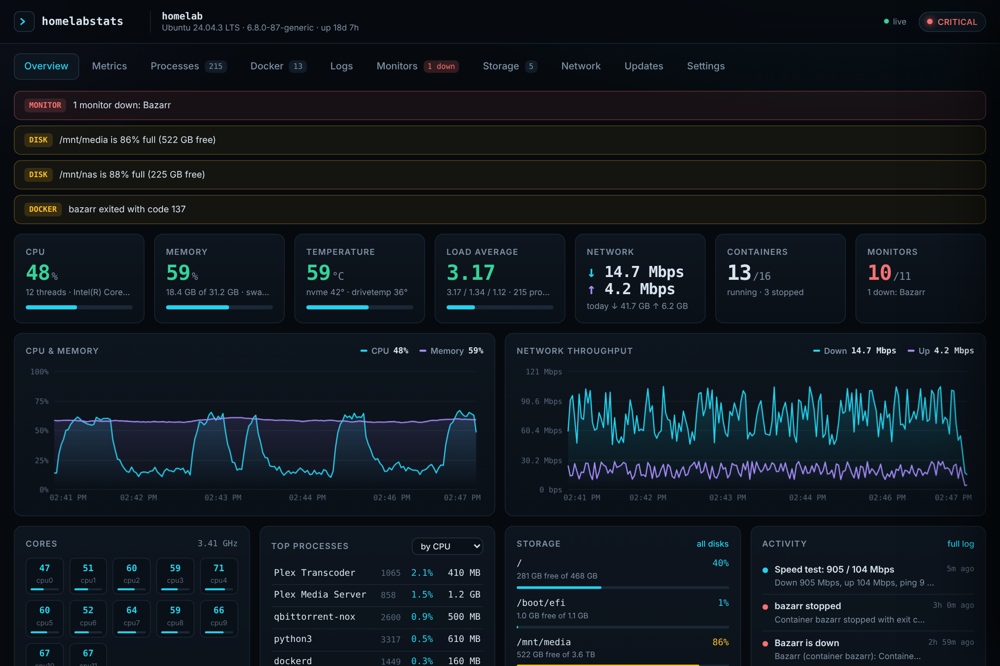
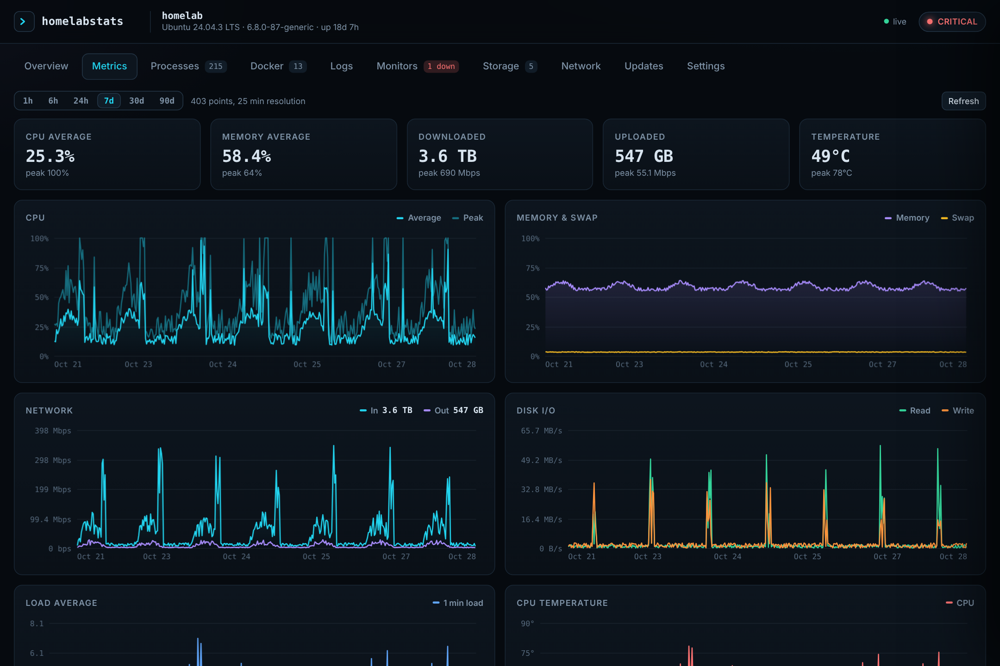
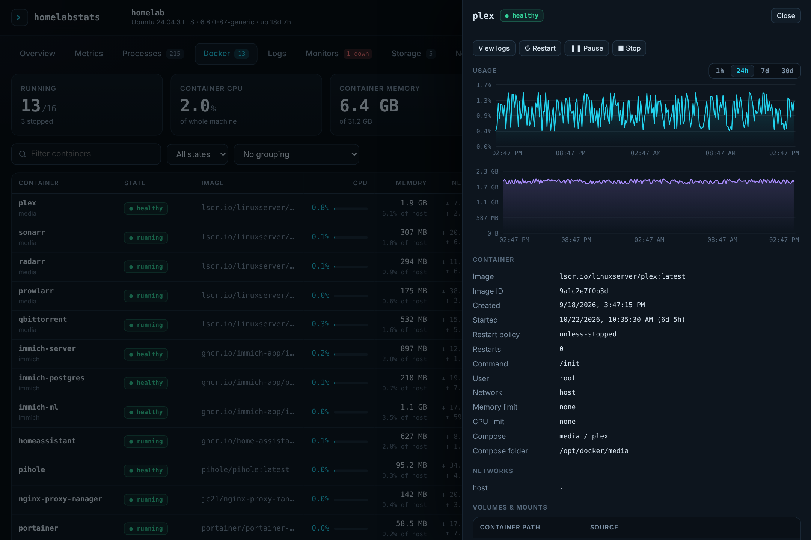
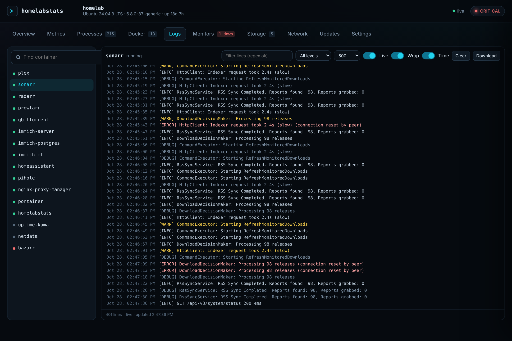
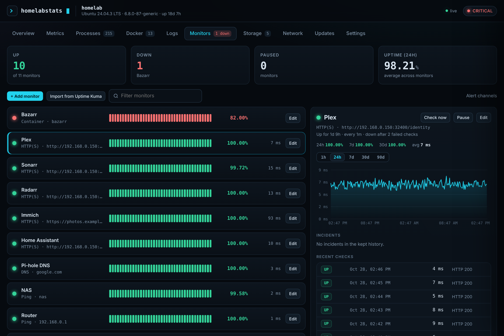
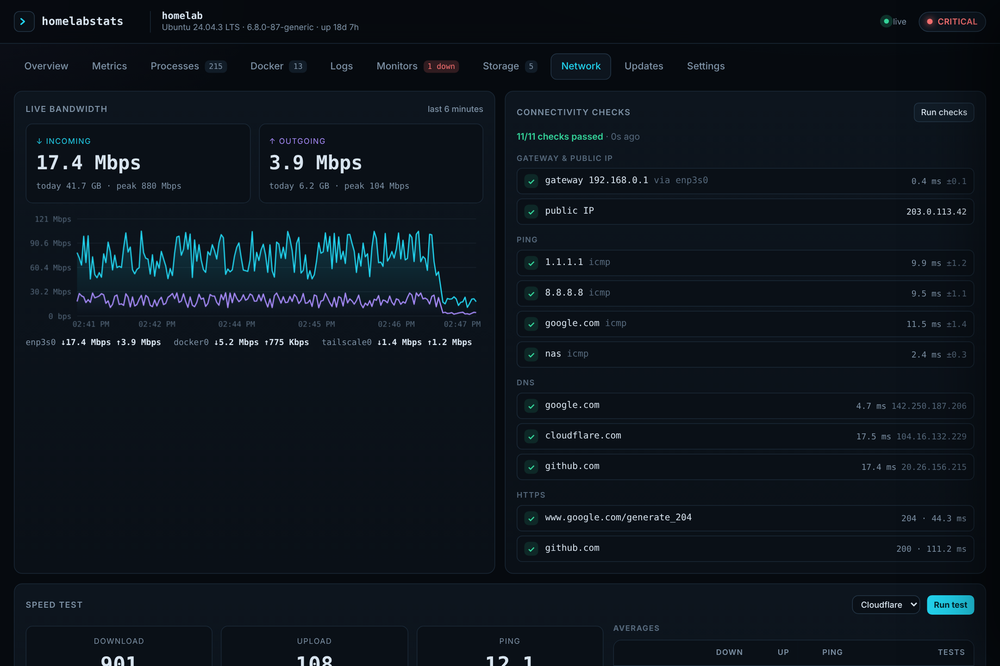
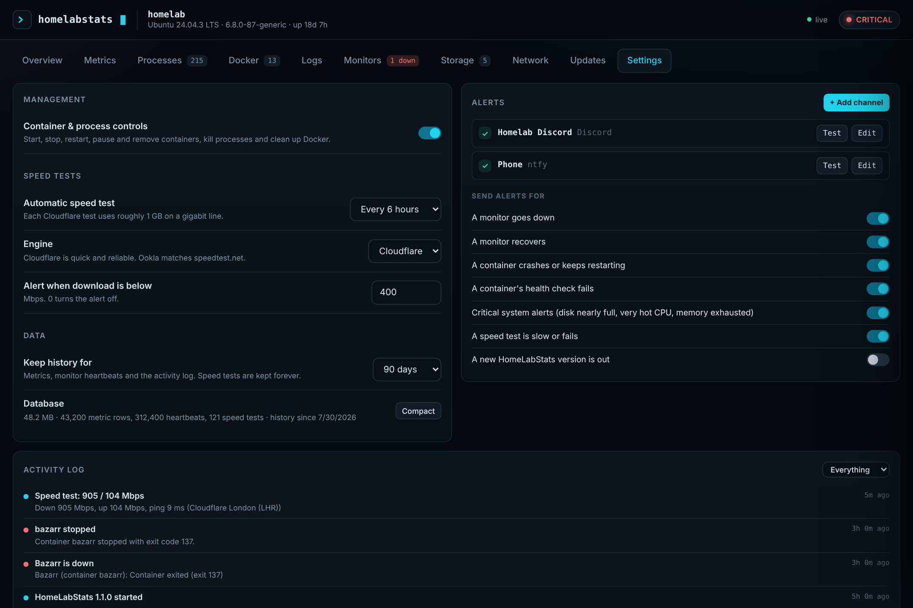

<div align="center">

# `>_` HomeLabStats

**Your home server, at a glance. One app instead of five.**

A fast, self-hosted dashboard for your Linux server: live stats and long-term history, Docker
management and live logs, uptime monitors with alerts, and speed tests. It replaces Netdata,
Glances, Dozzle, Uptime Kuma and Speedtest Tracker, and updates itself from GitHub with one click.

[**Live demo**](https://bhxuk.github.io/HomeLabStats/demo/) ·
[**Website**](https://bhxuk.github.io/HomeLabStats/) ·
[Install](#install) ·
[Replacing other tools](#replacing-other-tools) ·
[Changelog](CHANGELOG.md)



</div>

## Features

| Tab | What it does | Replaces |
|---|---|---|
| **Overview** | Health status, alerts, live CPU / memory / network charts, cores, top processes, disks, containers, monitors and recent activity | |
| **Metrics** | History from 1 hour to 90 days for CPU, memory, swap, load, temperature, network and disk I/O, per-container CPU / memory / network, and every temperature sensor, fan, core clock and logged-in user | Netdata, Glances |
| **Processes** | Every process on the host, sortable and searchable, tagged with the container that owns it. End or force-kill a process | Glances, htop |
| **Docker** | Start, stop, restart, pause and remove containers. Details panel with ports, volumes, networks, restart policy, health check log and usage history. Disk usage and one-click cleanup of unused images, build cache and stopped containers | Portainer (day-to-day) |
| **Logs** | Live tail of any container's logs with regex search and highlighting, error / warning colouring, level filter, wrap and timestamp toggles, download | Dozzle |
| **Monitors** | HTTP(S) with status codes and keywords, TCP port, ping, DNS and Docker container checks. Uptime % for 24h / 7d / 30d, response time charts, incidents, heartbeat bars. **One-click import from Uptime Kuma** | Uptime Kuma |
| **Storage** | Used and free space on every disk including SMB / NFS shares, plus live disk activity | |
| **Network** | Live incoming and outgoing bandwidth with daily totals, connectivity checks (gateway, ping, DNS, HTTPS, public IP), interfaces, and speed tests with a permanent log, schedule, averages and CSV export | Speedtest Tracker |
| **Updates** | Checks GitHub, shows the changelog and installs updates with one click, then restarts itself | |
| **Settings** | Container controls on/off, speed test schedule and slow-speed alert, alert channels, what to alert on, history retention, and the activity log | |

**Alerts** go to Discord, Telegram, ntfy, Slack or any webhook when a monitor goes down or recovers, a container
crashes or fails its health check, a disk is nearly full, the CPU is overheating, a speed test is slow, or an update is out.

No agents and no cloud account. One small Python service (FastAPI + psutil + Docker SDK) with a single SQLite file
for history, and a frontend with no build step and no external dependencies, so it works on an offline LAN.

<table><tr>
<td></td>
<td></td>
</tr><tr>
<td></td>
<td></td>
</tr><tr>
<td></td>
<td></td>
</tr></table>

## Install

Requirements: a Linux server (Ubuntu, Debian, Fedora, Arch and friends) with either Docker
or Python 3.10+ and systemd.

### Option 1: Docker Compose (recommended)

```bash
git clone https://github.com/bhxuk/HomeLabStats
cd HomeLabStats
cp .env.example .env
nano .env                 # set DASH_PASSWORD, add your own devices to PING_TARGETS
docker compose up -d
```

Open `http://<server-ip>:8090` and sign in as `admin` with your password.

The container uses host networking and the host PID namespace so it can see real interfaces and every
process, mounts the host filesystem read-only for disk stats, and talks to Docker through its socket.
Your clone is mounted into the container so the in-app updater can pull new versions into it.

### Option 2: Bare metal (systemd)

```bash
curl -fsSL https://raw.githubusercontent.com/bhxuk/HomeLabStats/main/install.sh | sudo bash
```

This installs to `/opt/homelabstats` with its own Python virtualenv and a `homelabstats` service user
(added to the `docker` group if Docker is installed), writes settings to `/etc/homelabstats.env` with a
generated password, and starts the `homelabstats` service. The password is printed at the end.

```bash
systemctl status homelabstats
journalctl -u homelabstats -f
sudo nano /etc/homelabstats.env && sudo systemctl restart homelabstats
```

To remove it: `sudo /opt/homelabstats/uninstall.sh` (add `--purge` to delete settings and history too).

## Replacing other tools

Once HomeLabStats is running, you can retire the tools it replaces and free up their CPU, RAM and disk:

1. **Uptime Kuma:** open **Monitors → Import from Uptime Kuma** while the Kuma container still exists (running or
   stopped). Your monitors and Discord / Telegram / ntfy / Slack / webhook channels are copied across. Monitors that
   used Docker container names in URLs (like `http://sonarr:8989`) should be changed to the server's IP, because
   HomeLabStats checks from the host.
2. **Speedtest Tracker:** turn on automatic speed tests in **Settings** (every 6 hours is a good start) and set a
   slow-speed alert if you want one.
3. **Alerts:** add your channels in **Settings → Alerts** and press **Test** on each.
4. **Remove the old containers:** stop them from the **Docker** tab, check everything still looks right for a day,
   then remove them there too.
5. **Reclaim the space:** **Docker → Disk usage & cleanup → Remove unused** deletes their images.

Netdata, Glances and Dozzle need no migration: HomeLabStats starts recording history the moment it starts.

## Updating

Open the **Updates** tab. When a new version is out you will see a badge, the changelog for everything
new since your version, and an **Update** button. HomeLabStats then:

1. fetches the latest code from GitHub and fast-forwards your install,
2. installs any new Python packages,
3. restarts itself (Docker's restart policy or systemd brings it straight back), and the page reloads.

Set `AUTO_UPDATE=true` to install new versions automatically. Your settings live in `.env`, `/etc/homelabstats.env`
and the app's database, which updates never touch.

Manual alternatives: `git pull && docker compose up -d --build`, or re-run the installer.

## Configuration

Most options are in the app's **Settings** tab: container controls, the speed test schedule and engine, the
slow-speed alert, alert channels and triggers, and how long to keep history (90 days by default).

Start-up options go in `.env` (Docker) or `/etc/homelabstats.env` (systemd), followed by a restart:

| Variable | Default | What it does |
|---|---|---|
| `PORT` | `8090` | Port the dashboard listens on |
| `DASH_USER` / `DASH_PASSWORD` | `admin` / empty | HTTP basic auth. Empty password disables login (not recommended) |
| `PING_TARGETS` | `1.1.1.1,8.8.8.8,google.com` | Hosts pinged by the connectivity checks. Add your router, NAS or Tailscale peers |
| `DNS_NAMES` | `google.com,cloudflare.com,github.com` | Names resolved to test DNS |
| `HTTP_CHECKS` | Google 204, github.com | URLs fetched to confirm HTTPS works end to end |
| `UPDATE_CHECK_HOURS` | `6` | How often to check GitHub for a new version |
| `AUTO_UPDATE` | `false` | Install new versions automatically |
| `DISK_PATHS` | auto | Comma separated mount points to show instead of auto-detecting |
| `SAMPLE_INTERVAL` | `2` | Seconds between live samples |

History is stored in `homelabstats.db` in the data folder (`./data` for Docker, `/var/lib/homelabstats` for systemd).
Expect roughly 30 to 80 MB for 90 days on a typical home server; **Settings → Database → Compact** shrinks it.

## Security

- Always set `DASH_PASSWORD`. Access to the Docker socket is equivalent to root on the host.
- Keep it on your LAN. For remote access use Tailscale or another VPN rather than port forwarding.
- Container and process controls can be switched off in **Settings**. HomeLabStats will never stop, pause or
  remove its own container.

## Troubleshooting

- **No temperatures or fans:** install `lm-sensors` on the host and run `sudo sensors-detect`. NVMe and `drivetemp` drive temperatures show automatically.
- **Docker tab says not reachable:** check `/var/run/docker.sock` is mounted (Docker install) or the `homelabstats` user is in the `docker` group (bare metal), then restart.
- **Kuma import can't find the database:** the Uptime Kuma container must still exist and keep its data in a volume mounted at `/app/data`.
- **A mounted share is missing on Storage:** with Docker, the share must be mounted on the host before the container starts, or restart the container after mounting.
- **Update failed, "could not fast-forward":** files in the install folder were edited. Run `git status` there, then `git stash` or `git checkout -- <file>`.

## Development

```bash
pip install -r requirements.txt
DATA_DIR=./data python -m app.main      # http://localhost:8090
# http://localhost:8090/?demo shows simulated data
./scripts/build-pages.sh                # refresh the GitHub Pages demo after UI changes
```

Backend modules live in `app/` (see the docstring at the top of `app/main.py`), the frontend in `app/static/`
with one script per tab in `app/static/js/`. Every change to `main` must bump `app/VERSION` and add a
`CHANGELOG.md` entry, because installed copies update from them. See [CLAUDE.md](CLAUDE.md) for the checklist.

## Licence

[MIT](LICENSE)
