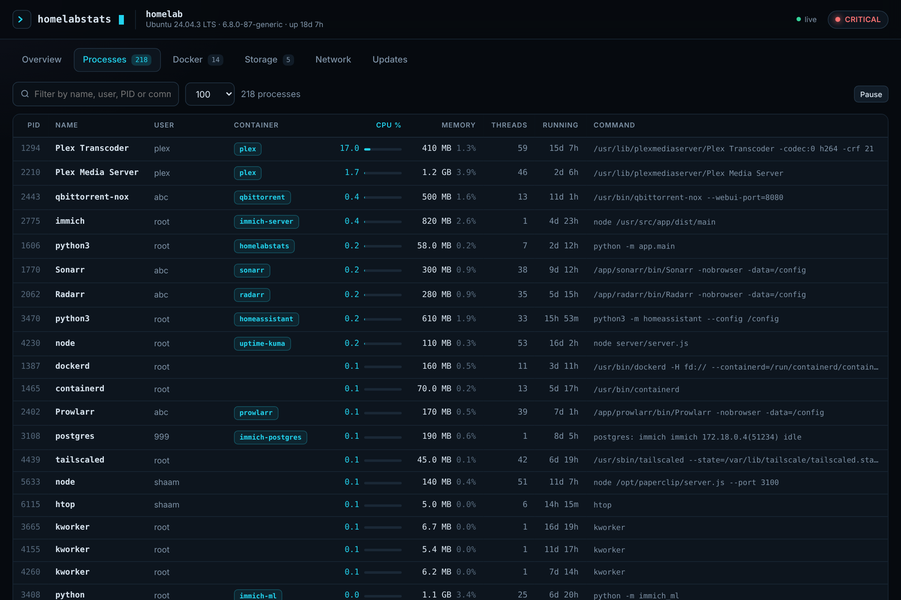
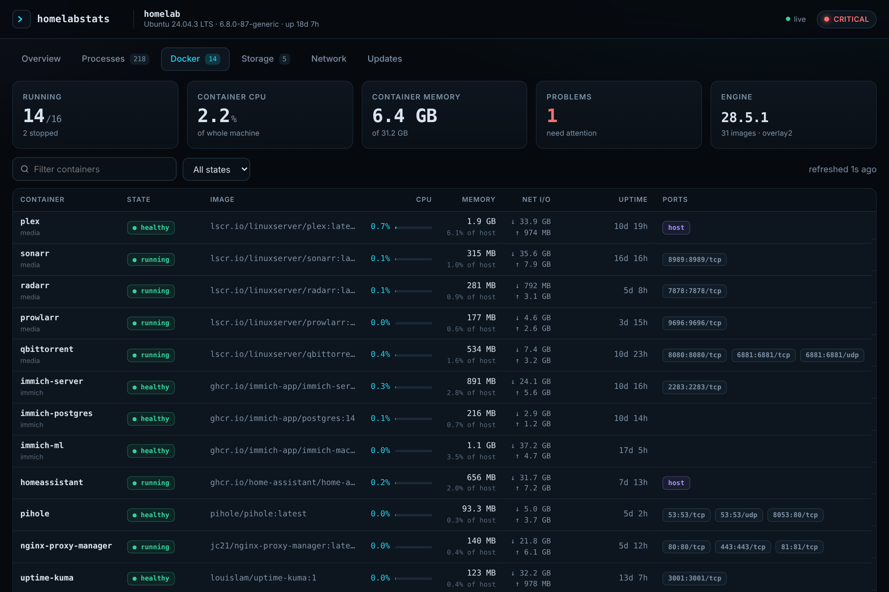
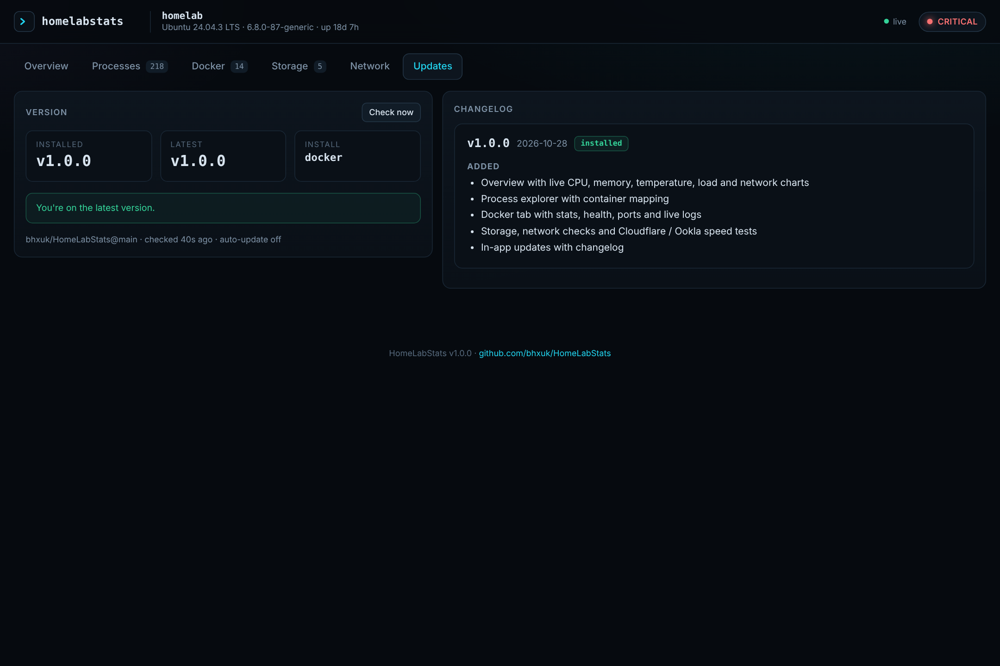

<div align="center">

# `>_` HomeLabStats

**Your home server, at a glance.**

A fast, self-hosted dashboard for your Linux server: CPU, memory, every running process,
Docker containers, disk space, network health and speed tests, all live on one page.
It updates itself from GitHub with one click.

[**Live demo**](https://bhxuk.github.io/HomeLabStats/demo/) ·
[**Website**](https://bhxuk.github.io/HomeLabStats/) ·
[Install](#install) ·
[Configuration](#configuration) ·
[Changelog](CHANGELOG.md)


</div>

## Features

| | |
|---|---|
| **System health** | Live CPU, memory, swap, load and temperatures with rolling charts, per-core bars and health alerts |
| **Processes** | Every process on the host, sortable by CPU, memory, threads or age, searchable, and tagged with the Docker container that owns it |
| **Docker** | Running and stopped containers with health, CPU, memory, network I/O, ports and uptime, a live log viewer and optional start/stop/restart |
| **Storage** | Used, free and total space for every real disk including SMB/NFS mounts, plus live read/write activity |
| **Network** | Gateway, ping, DNS and HTTPS checks, public IP, per-interface throughput |
| **Speed tests** | Cloudflare or Ookla, with ping, jitter, history chart and an optional schedule |
| **Updates** | Checks GitHub for new versions, shows the changelog and installs updates in one click, then restarts itself |

No agents, no database, no cloud account. One small Python service (FastAPI + psutil + Docker SDK)
and a single-page frontend with no external dependencies, so it works on an offline LAN.

<table><tr>
<td></td>
<td></td>
</tr><tr>
<td></td>
<td></td>
</tr></table>

## Install

Requirements: a Linux server (Ubuntu, Debian, Fedora, Arch and friends) with either Docker
or Python 3.10+ and systemd.

### Option 1: Docker Compose (recommended)

```bash
git clone https://github.com/bhxuk/HomeLabStats
cd HomeLabStats
cp .env.example .env
nano .env                 # set DASH_PASSWORD, add your own devices to PING_TARGETS
docker compose up -d
```

Open `http://<server-ip>:8090` and sign in as `admin` with your password.

The container uses host networking and the host PID namespace so it can see real interfaces and every
process, and mounts the host filesystem read-only for disk stats. Your clone is mounted into the
container so the in-app updater can pull new versions into it.

### Option 2: Bare metal (systemd)

```bash
curl -fsSL https://raw.githubusercontent.com/bhxuk/HomeLabStats/main/install.sh | sudo bash
```

This installs to `/opt/homelabstats` with its own Python virtualenv and a `homelabstats` service user
(added to the `docker` group if Docker is installed), writes settings to `/etc/homelabstats.env` with a
generated password, and starts the `homelabstats` service. The password is printed at the end.

```bash
systemctl status homelabstats
journalctl -u homelabstats -f
sudo nano /etc/homelabstats.env && sudo systemctl restart homelabstats
```

To remove it: `sudo /opt/homelabstats/uninstall.sh` (add `--purge` to delete settings and history too).

## Updating

Open the **Updates** tab. When a new version is out you will see a badge, the changelog for everything
new since your version, and an **Update now** button. HomeLabStats then:

1. fetches the latest code from GitHub and fast-forwards your install,
2. installs any new Python packages,
3. restarts itself (Docker's restart policy or systemd brings it straight back), and the page reloads.

Set `AUTO_UPDATE=true` to install new versions automatically. Your settings live in `.env` or
`/etc/homelabstats.env`, which updates never touch.

Manual alternatives: `git pull && docker compose up -d --build`, or re-run the installer.

## Configuration

Set these in `.env` (Docker) or `/etc/homelabstats.env` (systemd), then restart.

| Variable | Default | What it does |
|---|---|---|
| `PORT` | `8090` | Port the dashboard listens on |
| `DASH_USER` / `DASH_PASSWORD` | `admin` / empty | HTTP basic auth. Empty password disables login (not recommended) |
| `ALLOW_CONTAINER_ACTIONS` | `false` | Show start, stop and restart buttons on the Docker tab |
| `PING_TARGETS` | `1.1.1.1,8.8.8.8,google.com` | Hosts pinged by the connectivity checks. Add your router, NAS or Tailscale peers |
| `DNS_NAMES` | `google.com,cloudflare.com,github.com` | Names resolved to test DNS |
| `HTTP_CHECKS` | Google 204, github.com | URLs fetched to confirm HTTPS works end to end |
| `SPEEDTEST_INTERVAL_HOURS` | `0` | Run a Cloudflare speed test every N hours. `0` = manual only |
| `UPDATE_CHECK_HOURS` | `6` | How often to check GitHub for a new version |
| `AUTO_UPDATE` | `false` | Install new versions automatically |
| `DISK_PATHS` | auto | Comma separated mount points to show instead of auto-detecting |
| `SAMPLE_INTERVAL` | `2` | Seconds between samples for the live charts |
| `HISTORY_POINTS` | `180` | Number of samples kept for the charts |

## Security

- Always set `DASH_PASSWORD`. Access to the Docker socket is equivalent to root on the host.
- Keep it on your LAN. For remote access use Tailscale or another VPN rather than port forwarding.
- Container actions are off by default; enable them only if you want them.

## Troubleshooting

- **No temperatures:** install `lm-sensors` on the host and run `sudo sensors-detect`. NVMe and `drivetemp` drive temperatures show automatically.
- **Docker tab says not reachable:** check `/var/run/docker.sock` is mounted (Docker install) or the `homelabstats` user is in the `docker` group (bare metal), then restart.
- **A mounted share is missing on Storage:** with Docker, the share must be mounted on the host before the container starts, or restart the container after mounting.
- **Update failed, "could not fast-forward":** files in the install folder were edited. Run `git status` there, then `git stash` or `git checkout -- <file>`.

## Development

```bash
pip install -r requirements.txt
DATA_DIR=./data python -m app.main      # http://localhost:8090
# http://localhost:8090/?demo shows simulated data
./scripts/build-pages.sh                # refresh the GitHub Pages demo after UI changes
```

Every change to `main` must bump `app/VERSION` and add a `CHANGELOG.md` entry, because installed copies
update from them. See [CLAUDE.md](CLAUDE.md) for the release checklist.

## Licence

[MIT](LICENSE)
